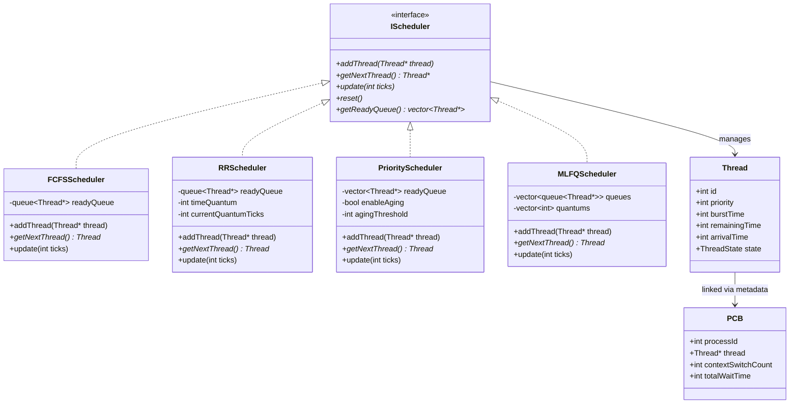
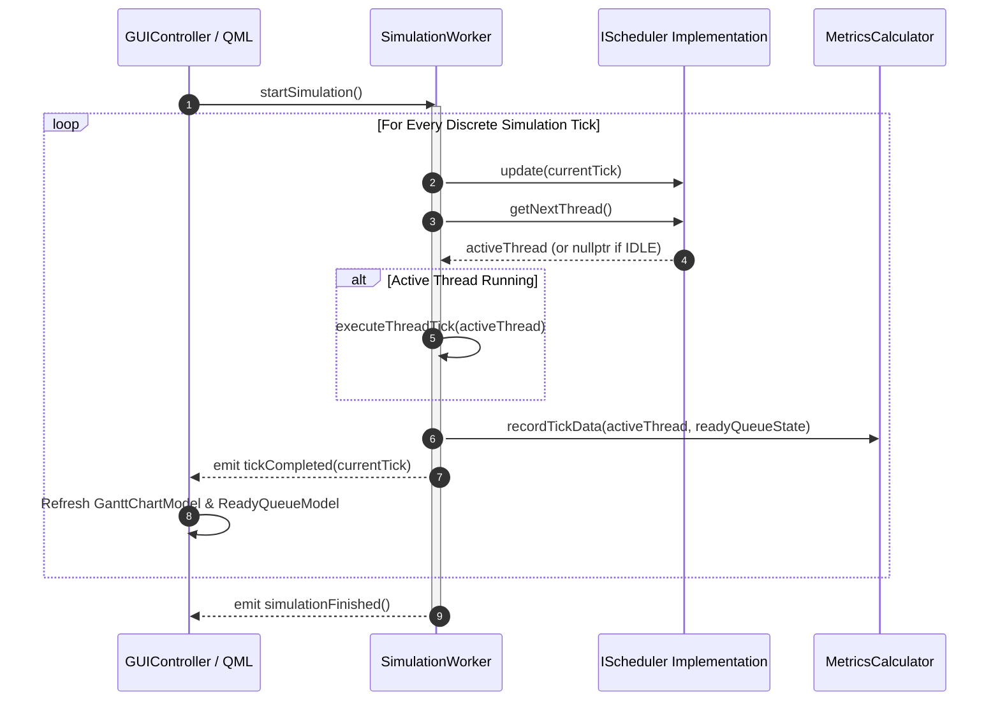
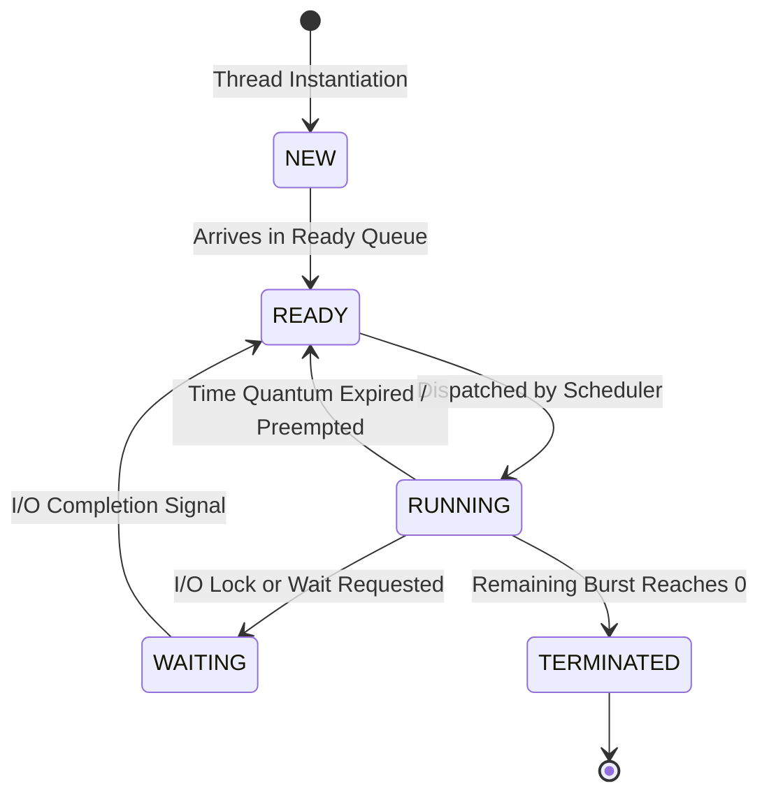

# Architecture Documentation

This document provides a detailed overview of the system architecture, component interactions, and state machines for the **Thread Scheduler Visualizer** project.

---

## 1. Class Diagram (Core Engine & Data Models)

The following diagram illustrates the relationship between the polymorphic scheduler interfaces, concrete scheduling algorithm implementations, and underlying domain entities (`Thread`, `PCB`).

---

## 2. Sequence Diagram (Simulation Execution Lifecycle)

The sequence diagram below highlights how the `GUIController` delegates execution ticks to the worker thread (`SimulationWorker`), updating scheduling mathematics and notifying QML view models.

---

## 3. State Diagram (Thread Lifecycle FSM)

This diagram documents the formal Finite State Machine (FSM) transitions experienced by every thread managed within the scheduling system.

---

## 4. Layering & Separation of Concerns

The project adheres strictly to a clean separation between Core Engine logic and GUI View Models:

1. **Core Domain Layer (`include/core/`, `src/core/`)**: Independent of any Qt framework dependencies. Contains mathematical algorithms, scheduling policies, and metric collectors.
2. **Adapter & View Model Layer (`include/gui/`, `src/gui/`)**: Implements `QAbstractListModel` wrappers (`GanttChartModel`, `ReadyQueueModel`, `ThreadListModel`) and bridges C++ signals to QML slots.
3. **Declarative UI Layer (`src/qml/`)**: Reactive QML views and visual components for rendering comparative graphs, Gantt bars, and state diagrams.